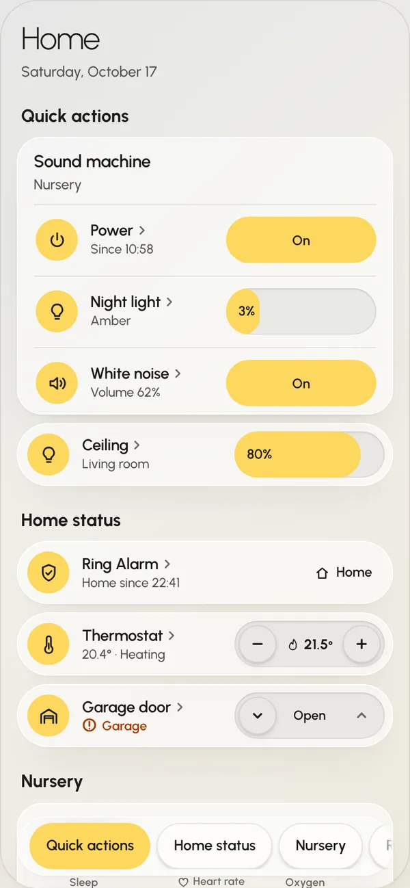
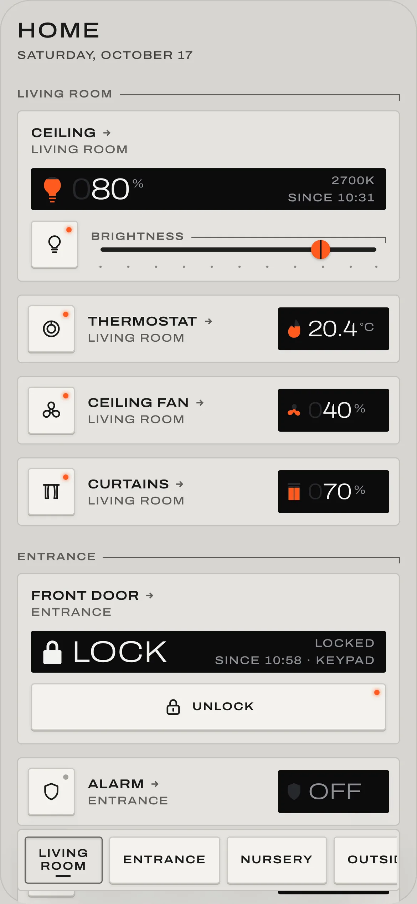

# Dashhaus

[](https://github.com/Krystosterone/dashhaus/actions/workflows/ci.yml)
[](https://github.com/Krystosterone/dashhaus/actions/workflows/hacs.yml)
[](LICENSE)
[](https://github.com/Krystosterone/dashhaus/releases/latest)
[](https://www.npmjs.com/package/@dashhaus/core)

Home Assistant dashboards drawn in React: two finished looks, Orb and Field, that you install from the Marketplace,
and the headless hooks under them to draw your own.

<p>
  
  
</p>

Documentation: **[krystosterone.github.io/dashhaus](https://krystosterone.github.io/dashhaus/)**, with Storybook at
[/storybook](https://krystosterone.github.io/dashhaus/storybook/).

## Beta

Dashhaus is in beta and hasn't been tried on many homes yet, so it can still change quickly:

- **An update can ask something of you.** An update may rename a YAML key, change a hook or redraw a card. Each
  [release](https://github.com/Krystosterone/dashhaus/releases) says what changed and what to do; read it before you
  update.
- **Your existing dashboards are safe.** The setup card and the deploy command only create dashboards; they never
  change one that exists. The ones they create follow Dashhaus as it updates.
- **Real devices vary.** Every card is tested on Home Assistant's standard entities, but an integration may report
  its device in a way no card expects yet. Locks, alarm panels and covers act on real things: try each one once
  while you can see it.
- **Testers wanted.** Put it on your house, a phone or a wall panel, and tell us what you find: a card that draws
  wrong, a device it misreads or doesn't draw, or simply that it works on your setup.
  [Open an issue](https://github.com/Krystosterone/dashhaus/issues/new/choose); your Home Assistant and Dashhaus
  versions and a screenshot help most.

For code that uses the packages: beta versions are `0.x`, and a change that breaks something moves the middle number
(0.2 → 0.3). A caret range stays on one `0.x` line, so moving to the next is a step you take; every `@dashhaus/`
package shares one version, so move them together. 1.0 will be the first stable release.

## Install

[](https://my.home-assistant.io/redirect/hacs_repository/?owner=Krystosterone&repository=dashhaus&category=plugin)

No terminal needed, as a Home Assistant administrator:

1. Open the link above. Home Assistant 2026.11 or newer opens the Marketplace; older versions need
   [HACS](https://www.hacs.xyz/docs/use/). Add Dashhaus as a custom repository of type **Dashboard** if asked, then
   download it.
2. Reload the browser tab.
3. On **Overview**: **⋮ → Edit dashboard → Add card → Dashhaus setup**, save, and press **Create dashboards**.
4. Open **Home (Orb)** or **Home (Field)** from the card's links, then remove the setup card. It never changes a
   dashboard that exists.

For scripted installs or CI, [deploy from the command line](https://krystosterone.github.io/dashhaus/start/deploy/).

## Four ways in

| You want | Start at |
| --- | --- |
| Orb or Field on your Home Assistant | [Install from the Marketplace](https://krystosterone.github.io/dashhaus/start/install/), or [from the command line](https://krystosterone.github.io/dashhaus/start/deploy/) for a script or CI |
| A look of your own | [Build a skin](https://krystosterone.github.io/dashhaus/start/build-a-skin/): `npm create dashhaus-skin@latest my-skin` |
| Home Assistant's entities in your own React app | [Use the hooks in your app](https://krystosterone.github.io/dashhaus/start/getting-started/): `@dashhaus/core` alone |
| To change Dashhaus itself | [Develop](#develop) below, and [AGENTS.md](AGENTS.md) |

Each way in is proved from the packed release on every change; [spec/journeys.md](spec/journeys.md) lists them.

## Develop

This repository is a component library, developed and checked in Storybook: two skins, Orb and Field, on the same
entity models and Home Assistant hooks, each with its own cards, dashboard furniture and Lovelace card
(`custom:dashhaus-orb`, `custom:dashhaus-field`).

```sh
corepack enable npm
npm install
npm run storybook
```

Requires Node 22.23.4 or later (`.nvmrc` pins it) and the npm `packageManager` pins. Storybook runs at
http://localhost:6006 and documents every card, supported footprint and skin, each skin under the same groups: Cards,
Bundles (Orb only), Dashboards, Foundations, Connected. Use the Theme menu to switch between Auto (system), Light and
Dark.

Create a new skin from the neutral shell:

```sh
npm run new-skin -- canvas
```

It registers the skin's Foundations, Dashboard, its own entry and Lovelace card; add real entity Cards with `npm run new-card -- light --skin canvas`. See [spec/skins.md](spec/skins.md).

### Packages

`@dashhaus/core`, `@dashhaus/dashboard` and `@dashhaus/deploy` are the headless foundation, the framework and the
deploy CLI; `@dashhaus/orb` and `@dashhaus/field` are the two skins. `@dashhaus/bundle` ships the prebuilt one-file
Lovelace bundle: a deploy-only app installs it with the CLI, names `fileURLToPath(bundlePath)` in its config and runs
`npx dashhaus-deploy --skip-build`. `create-dashhaus-skin` scaffolds a standalone skin. Package READMEs live in each
package; the release policy is [spec/release.md](spec/release.md).

### Running with Home Assistant

Fill in `.env` and deploy:

```sh
npm run deploy
```

It installs one bundle carrying `custom:dashhaus-orb` (Orb), `custom:dashhaus-field` (Field), the setup card and every registered generated skin, then creates one dashboard for each the first time, from the set declared in `dashboard.config.mjs`. You edit any Lovelace card's YAML in Home Assistant. See [spec/deploy.md](spec/deploy.md). Measure the deployed pages with `npm run perf:collect`; see [spec/performance.md](spec/performance.md). The data boundary, the shared `useHa<Kind>` hooks and the injected transport are in [spec/home-assistant.md](spec/home-assistant.md).

## Spec

The specification the code is held to, written for maintainers and agents. Tests, generators and Storybook read these files.

| File | What it covers |
| --- | --- |
| [spec/orb.md](spec/orb.md) | Orb's design and composition rules |
| [spec/field.md](spec/field.md) | Field's design and composition rules |
| [spec/cards.md](spec/cards.md) | Per-card behaviour |
| [spec/home-assistant.md](spec/home-assistant.md) | The Home Assistant data boundary and hooks |
| [spec/core.md](spec/core.md) | The core contract, error metadata, transport lifecycle and auth boundary |
| [spec/deploy.md](spec/deploy.md) | Deploying the bundle and the Lovelace YAML |
| [spec/performance.md](spec/performance.md) | The deployed pages' performance marks and report |
| [spec/skins.md](spec/skins.md) | Starting a skin in this repository |
| [spec/build-a-skin.md](spec/build-a-skin.md) | Building a standalone skin from the published packages |
| [spec/contract.md](spec/contract.md) | What a third-party skin may rely on |
| [spec/journeys.md](spec/journeys.md) | The four ways in, and what proves each |
| [spec/release.md](spec/release.md) | Building and releasing the public packages |

## Contributing

Ask questions and agree proposed changes in [GitHub Issues](https://github.com/Krystosterone/dashhaus/issues). Pull requests are accepted after that agreement. Before opening one, run `npm run check` and `npm run test-storybook`, document behavior changes, and preserve the domain → Home Assistant → skin import direction. [CONTRIBUTING.md](CONTRIBUTING.md) has the steps, and [SECURITY.md](SECURITY.md) how to report a vulnerability privately.

## License

MIT — see [LICENSE](LICENSE).

Third-party material keeps its own terms: the agent skills and design roles under `.agents/` installed from upstream
projects (Emil Kowalski's skills, Impeccable, agency-agents) are not covered by this repository's license. Each one's
license sits beside it, and [.agents/skills/THIRD_PARTY.md](.agents/skills/THIRD_PARTY.md) lists which is which.
