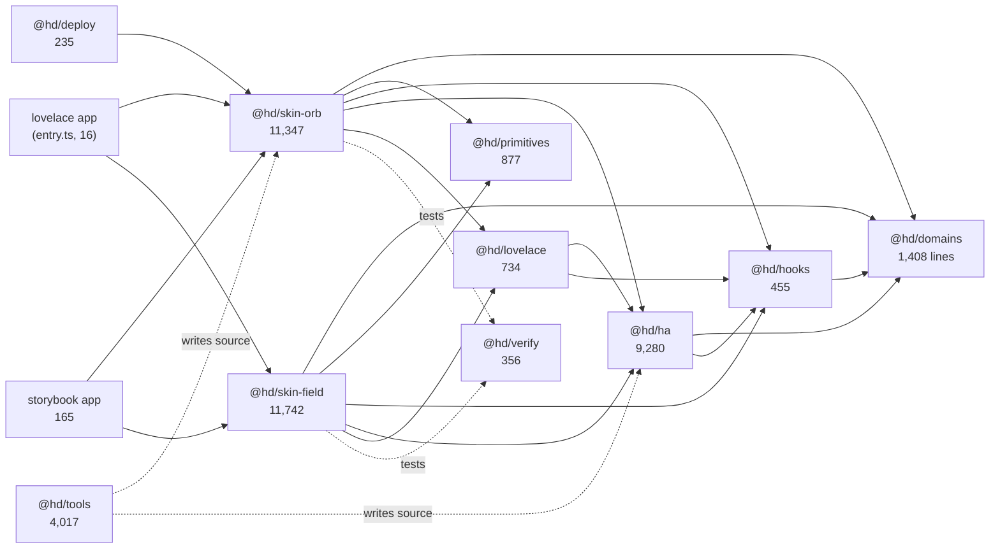
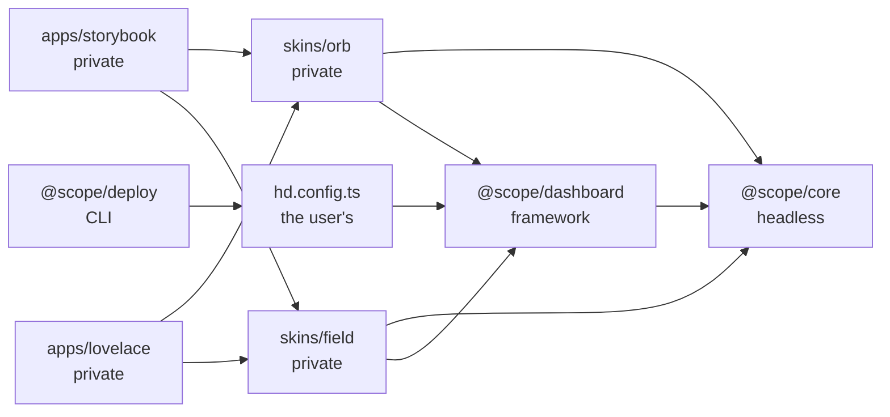

# Research: Monorepo readiness

## Research Question

> Outcome: find out whether this repo is decoupled enough to become a monorepo
> with packages for the headless components, each skin, deploy, and anything
> else that earns its own package. Where it isn't, say exactly what's in the way.
> Assessment only.
>
> Standard: AGENTS.md → Layout describes boundaries (the ESLint rules,
> src/skins/boundaries.test.ts). Treat them as claims to check against the real
> import graph, not as the answer. Where the docs and the code disagree, the code
> wins; report the difference. Use the codebase-design skill for where seams go.
> "Headless components" is my word; if it maps to more than one thing in the
> repo, say which reading you took.
>
> I'm deliberately not giving you a package map. Propose one from what the
> imports show.
>
> Scope: out of scope here: moving files, adding workspaces, editing
> package.json or any config. Read and report.
>
> Finish line: a report under docs/research/ (research-codebase convention),
> summarized back here, with:
> - the verdict up top: ready, ready after N cuts, or not yet
> - the package map: each proposed package, what goes in it, and which
>   packages it depends on, as a graph
> - every blocker: the import or file that crosses a package line
>   (file:line), the cut that fixes it, and its rough size
> - every place AGENTS.md's boundaries don't match the code
> Before handing back, check that every dependency edge in the map points to a
> real import you found, not one you inferred from folder names.

## Summary

> **Map superseded (2026-10-29 follow-up).** The external-consumer goals and the
> minimal-package constraint replace the 12-member map below with three packages
> — `@scope/core`, `@scope/dashboard`, `@scope/deploy` — and make the reference
> skins private apps. The five cuts and every AGENTS.md finding stand; the
> external goals add one extraction, C6. Read *Follow-up Research* at the end
> before the package table.

**Verdict: ready after 5 cuts.** The runtime import graph is already a layered
DAG with the seams AGENTS.md claims: `domains` and `primitives` at the bottom,
`hooks` above `domains`, `ha` above both, `lovelace` above `ha`, skins above all
of them. At file level there are zero cycles; at package level there is exactly
one, created by one 15-line file (`src/ha/lovelace/entry.ts`) that imports both
skins to register their custom elements. No mapper, card, primitive or hook has
to change behaviour to move.

What is in the way is not tangled code but **ownership**:

1. The bundle entry lives inside the shared Lovelace package and depends on both skins.
2. The repo-wide verifier (`src/skins/{conformance.ts,boundaries.test.ts,storybook.test.ts}` plus both per-skin conformance tests) lives in the skins directory, reads files by repo-relative path, and asserts on `src/ha` *file paths* rather than its interface.
3. `src/index.ts` is a single 188-line public barrel that imports both skins' token CSS, so it cannot belong to any one package.
4. `scripts/deploy.mjs` imports orb's `auto.ts` by deep path *with a `.ts` extension*.
5. The generators write into every package by string anchors, and `new-skin` does not scaffold a package at all.

All five are cuts of existing files, not redesigns. Folder names are not enough
to infer any of the edges below: every edge is backed by an extracted import
(see Code References). The most expensive cut is the generators (~1,300 lines +
220 lines of tests); the rest are hours.

### What "headless components" means here

The phrase maps to three different things in this repo, so the reading matters:

| Reading | What it is | Taken? |
| --- | --- | --- |
| `src/ha/headless.tsx` | 43 lines of `<HaLight entityId>{(light) => …}</HaLight>` render-prop components over the `useHa*` hooks | No, on its own: too small to be a package; it is a subpath of the HA slice |
| `src/primitives/` | 877 lines of markup-free interaction hooks (`usePress`, `useSlider`, `useRangeSlider`, `useSheet`, `useKeypad`) | Yes, as its own package |
| `src/ha/` as a whole | store, provider, transport, mappers, actions, hooks and the headless components: UI-free by construction, consumed by every skin | Yes, as the main reading: `@hd/ha` |

I took the third reading as "the headless components" (the Home Assistant slice
that draws nothing), kept `@hd/primitives` separate because it is literally
headless behaviour, and treated `headless.tsx` as the HA package's render-prop
entry rather than a package.

---

## Method

- Every static `import`, `export … from`, side-effect import and dynamic
  `import()` was extracted with the TypeScript parser (`ts.createSourceFile`)
  from 524 files under `src/`, `.storybook/` and `scripts/` (`.ts`, `.tsx`,
  `.css`, `.mjs`), then relative specifiers were resolved against the
  filesystem: **2,288 statements, 2,181 resolving to a file**. The other 107 are
  generator template placeholders (`__Name__`, `__seedFile__`,
  `__transportPath__`), excluded. A second, independent line-regex pass produced
  the same package-level counts, so multi-line imports are not hiding edges.
- Excluded: `storybook-static/`, `dist/`, `node_modules/`, `.git/`, `.agents/`,
  `.claude/worktrees/`.
- `tsconfig.json` has no `baseUrl` and no `paths`: **every in-repo import is a
  relative path**. That is why the moves are mechanical (a codemod can rewrite
  them), and why the repo has no hidden alias layer.
- No CSS `@import` exists in any stylesheet, and no bare specifier resolves to
  `src/`. The graph below is therefore complete for TypeScript and stylesheet
  imports.
- Zero-edge checks, all measured: `domains → react` 0, `domains → UI` 0,
  `primitives → domains/hooks/ha/skins` 0, `hooks → primitives/ha/skins` 0,
  `ha (non-lovelace) → lovelace` 0, `ha (non-lovelace) → skins` 0,
  `lovelace → skins (excluding entry.ts)` 0, `skin → skin` 0,
  `skin presentation → ha` 0.

---

## Detailed Findings

### The graph, measured between the proposed package buckets

Type-only imports count, so the numbers measure coupling, not runtime cost. The
meta barrel and the bundle entry are files inside buckets, not nodes; Blockers
shows where they sit.

Solid edges are runtime imports. Dashed edges are not imports: the verifier is a
dev dependency of each skin's conformance test, and `@hd/tools` reads and writes
files by path without importing any package.

At file level there are **zero cycles** (Tarjan over all non-CSS imports). The
only package cycle is `lovelace → orb` at `src/ha/lovelace/entry.ts:4,6` versus
`orb → lovelace` at 13 sites; it exists solely because the bundle entry sits in
`@hd/lovelace`. Move the entry and the package graph is acyclic.

Within the skin edges, the split that matters: **no presentation file imports
`src/ha`** (0 measured). A skin reaches Home Assistant only from its `ha/`
(connected containers) and `lovelace/` (its custom element, config parser and
dashboard renderer), which is exactly the rule ESLint enforces. Edge counts:
orb → ha 30 runtime / 62 stories and tests; field → ha 22 runtime / 63 dev.
`@hd/ha` is therefore a *runtime* dependency of each skin package, not a dev
one.

### Proposed package map

The map below is what the imports support, not a target architecture. Line
counts include tests, stories and CSS.

| Workspace member | Contents | Lines / files | Depends on (runtime imports) | Kind |
| --- | --- | --- | --- | --- |
| `@hd/domains` | `src/domains/**`: entity and history types, pure logic (kelvin, modes, conditions, readings, positions, durations, labels, clock, colour, severity, format) | 1,408 / 40 | nothing in-repo; no React (lint-enforced) | library |
| `@hd/primitives` | `src/primitives/**`: `press`, `slider`, `range slider`, `sheet`, `keypad` | 877 / 8 | `react` | library |
| `@hd/hooks` | `src/hooks/**`: `useNow`, `useDelayLeft`, `useScrollSpy`, `useHashPage`, `useDemoClimate` | 455 / 9 | `react`, `@hd/domains` (2 imports, `useDemoClimate` only) | library |
| `@hd/ha` | `src/ha/**` minus `lovelace/`: types, store, provider, transport, registry, history, mappers, actions, hooks, `headless.tsx`, `demo.ts`, `demo/`, `testing.tsx`, `fixtures/`, and the `ha/index.ts` barrel | 9,280 / 98 | `react`, `home-assistant-js-websocket`, `@hd/domains` (41 runtime), `@hd/hooks` (10) | library |
| `@hd/lovelace` | `src/ha/lovelace/**` minus `entry.ts`: `element.tsx`, `yaml.ts`, `nav.ts`, `useDashboardNav.ts`, `styles.ts`, `actionMessage.ts`, `rooms.ts` | 734 / 10 | `react`, `react-dom/client`, `home-assistant-js-websocket`, `@hd/ha` (5), `@hd/hooks` (2) | library |
| `@hd/skin-orb` | `src/skins/orb/**`: shared card system, 10 cards, bundles, dashboards, Foundations stories, `ha/` tiles, `lovelace/` card + config + auto + renderer, token CSS, `storybook.tsx` | 11,347 / 151 | `react`, `@hd/domains` (44 runtime), `@hd/primitives` (9), `@hd/hooks` (2), `@hd/ha` (30), `@hd/lovelace` (12) | library |
| `@hd/skin-field` | `src/skins/field/**`: shared module system, 10 modules, dashboards, Foundations stories, `ha/` modules, `lovelace/` card + config + auto + renderer, token CSS, `storybook.tsx` | 11,742 / 123 | same as orb (domains 47, primitives 4, hooks 3, ha 22, lovelace 12) | library |
| `@hd/deploy` | `scripts/deploy.mjs`, `scripts/generated-skins.mjs` | 235 / 2 | `node:*`, `@hd/skin-orb` (1) | private bin |
| `@hd/tools` | `scripts/new-card/**`, `scripts/new-skin/**`, `scripts/test-storybook.mjs` | 4,017 / 90 | `node:*`, `vitest`; writes every package's source, imports none | private bin |
| `@hd/verify` | `src/skins/conformance.ts`, `src/skins/boundaries.test.ts`, `src/skins/storybook.test.ts`, both `cards/conformance.test.ts` | 356 / 5 | `node:fs`, `vitest`; reads every package's source and the repo docs | private test |
| storybook app | `.storybook/**` (preview, main, test-runner, blocks); the root configs live at the workspace root | 165 / 4 | `@hd/skin-orb`, `@hd/skin-field` (via `storybook.tsx`) | app |
| lovelace app | `src/ha/lovelace/entry.ts` (moved out of `@hd/lovelace`); `vite.lovelace.config.ts` stays a root config | 15 / 1 | `@hd/skin-orb`, `@hd/skin-field` | app / build entry |

Two decisions in that table, with evidence:

- **`@hd/lovelace` is a package, not a subpath of `@hd/ha`.** It is the only
  place that imports `react-dom/client` and `home-assistant-js-websocket`'s
  `Connection` and owns the shadow root, YAML and nav. Keeping it separate keeps
  `@hd/ha` usable without a DOM and keeps the dependency direction one-way
  (`ha → lovelace` is 0 edges). Delete it and both skins would reimplement the
  YAML reader, the custom-element base and the nav: it earns its keep.
- **The bundle entry is an app, not a package.** It has one implementation, one
  caller (`vite.lovelace.config.ts:46`) and no interface; its only job is
  to be the one place both skins are registered. A package for 15 lines fails
  the deletion test, but it must still move out of `@hd/lovelace`.

### Where the seams already are

- **`@hd/domains`**: no React, no CSS, no UI, 13 pure-logic test files. Already a
  deep module with a per-domain folder interface.
- **`@hd/primitives`**: behaviour and semantics only; every skin spreads the
  results onto its own markup. Already the repo's strongest seam.
- **`@hd/ha`**: 9,280 lines behind a 102-line barrel. The barrel is the seam, and
  the per-domain `hooks/<name>.ts` and `mappers/<name>.ts` (plus
  `actions/<name>.ts` for controls) are the local interface. This is the deepest
  module in the repo.
- **`@hd/lovelace`**: 734 lines, currently **seven deep file paths and no
  barrel**. The seam exists conceptually, not as an addressable interface.

### Where the seams are not

- **The verifier is inside the skins directory.** `src/skins/conformance.ts` is
  imported by each skin's conformance test
  (`src/skins/orb/cards/conformance.test.ts:7`,
  `src/skins/field/cards/conformance.test.ts:8`), and it resolves paths from
  `process.cwd()`. The conformance tests then assert on **`src/ha` file paths**
  (`src/skins/orb/cards/conformance.test.ts:59-62`: `src/ha/hooks/<name>.ts`,
  `src/ha/mappers/<name>.ts`, `src/ha/fixtures/<name>.json`,
  `src/ha/headless.tsx`) and on repo-root documents (`AGENTS.md`, `docs/cards.md`,
  `docs/deploy.md`, `src/index.ts`, `.storybook/preview.tsx`). Under the
  codebase-design rule "the interface is the test surface", these tests cross
  the HA package's seam: they would fail if `@hd/ha` reorganised its files
  without changing behaviour.
- **`.storybook/test-runner.ts:19-26` hardcodes field's CSS contract**
  (`#storybook-root .fd-module`, `.fd-name`) in the root runner, so the shared
  a11y gate knows one skin's class names. Not a package blocker, but it means
  the root harness is not skin-agnostic.
- **`@hd/hooks` is the shallowest package.** 455 lines, five unrelated hooks and
  no shared theme. It still passes the deletion test (`useNow` alone is imported
  by the ten `useHa*` hooks and both headers, `useDelayLeft` in both alarm cards,
  `useScrollSpy`/`useHashPage` in both navs), but it is a grab bag by
  construction, not a designed module.

---

## Blockers

Each row is a place where a package line would be crossed. "Crossing" is the
import or file; "size" is what the cut touches.

| # | Crossing | Why it blocks | Cut | Size |
| --- | --- | --- | --- | --- |
| C1 | `src/ha/lovelace/entry.ts:4-7` imports `../../skins/orb/styles/tokens.css`, `../../skins/field/styles/tokens.css`, `../../skins/orb/lovelace/card`, `../../skins/field/lovelace/card` | `@hd/lovelace` would depend on both skins while both skins depend on it: the only package cycle in the repo, 2 edges each way | Move `entry.ts` (15 lines) to the lovelace app; point `vite.lovelace.config.ts:46` at it; move the `new-skin` anchor (`scripts/new-skin/index.mjs:71-72`) | **S**: 15 lines + 3 references |
| C2 | `src/skins/conformance.ts:1-30`; `src/skins/boundaries.test.ts:10,21`; `src/skins/storybook.test.ts:46,57,61`; both `cards/conformance.test.ts`; `src/ha/lovelace/styles.test.ts:17-20` | The verifier reads every skin, the HA source tree, the meta barrel and the repo docs by `process.cwd()` path. It cannot belong to any package, and `@hd/lovelace`'s own test would fail without both skins present | Move the four test files + helper to `@hd/verify` (356 lines). Rewrite the HA assertions against `@hd/ha`'s public exports where possible and keep the fixture registration as a test owned by `@hd/ha`. Move the `:root`-scoping check (`src/ha/lovelace/styles.test.ts:17`) to `@hd/verify` or pass the skin list in | **M**: 356 lines moved, ~20 path assertions rewritten, one `vitest` include (`vitest.config.ts:7`), one ESLint ignore removed |
| C3 | `src/index.ts:1-188`, especially `:2-3` (both skins' token CSS) and the 124 orb + 41 field re-exports | One barrel mixes seven packages; importing it loads both skins' palettes as a side effect. Nothing inside the repo imports it, so it is a declared surface with no callers, and it is the only place the skins' public API exists | Delete the meta barrel. Each package gets an entry: `@hd/skin-orb` and `@hd/skin-field` export their own cards/containers/dashboards and import their own `tokens.css`; `@hd/ha`, `@hd/domains`, `@hd/primitives`, `@hd/hooks` keep/add theirs. Update the two conformance assertions (`orb:49`, `field:57`) and the generator anchors (`scripts/new-card/generated.mjs:149`, `scripts/new-skin/index.mjs:67-68`) | **M**: 188 lines split into ~7 entries; 4 anchors; no behaviour change |
| C4 | `scripts/deploy.mjs:11` — `import { autoDashboard, lovelaceDashboard } from "../src/skins/orb/lovelace/auto.ts"` | Deploy reaches into orb's source with a `.ts` extension, relying on Node type stripping. In a workspace it must be a package specifier; type stripping is disabled for files resolved under `node_modules`, so a copied (non-symlinked) install may fail | Export `auto` as a subpath of `@hd/skin-orb` (`./lovelace/auto`), import the specifier, and smoke-test `npm run deploy -- --skip-build` from a clean workspace install. If copying breaks stripping, give that subpath a compiled `.js` or move `autoDashboard` to a package that ships JS. It cannot move to `deploy`: orb's `card.tsx:44,80` calls it at runtime | **S**: 1 import + 1 `exports` entry; **risk M** (verify Node resolution) |
| C5 | `scripts/new-card/{index,field,generated,lib}.mjs:1-745`; `scripts/new-skin/index.mjs:1-79` | The generators write across every package by string anchors: `src/index.ts:102`, `src/ha/index.ts`, `src/ha/headless.tsx`, `src/ha/mappers/fixtures.test.ts`, `docs/*.md`, `AGENTS.md`, `.storybook/preview.tsx`, `src/ha/lovelace/entry.ts`, orb's `lovelace/{config,ConfigDashboard,auto}.ts(x)`, and `lib.mjs:43` reads orb's config text. `new-skin` creates a skin directory but no package manifest, exports or tsconfig, so a generated skin would not be a package | Keep the generators as `@hd/tools`, but make them package-aware: replace the ~50 path literals with package-path constants, have `new-skin` scaffold `package.json` + `exports` + tsconfig and register the skin with the lovelace app instead of the shared entry, and have `new-card` write the skin's own entry instead of the meta barrel. Update the two generator tests, which copy the repo and run the real pipeline (`scripts/new-card/index.test.ts:119`, `scripts/new-skin/index.test.ts:101`) | **L**: 1,326 generator lines + 220 test lines; ~50 anchors; new scaffolding output |

Not a blocker, but the only placement question the graph raises:
`src/hooks/useDemoClimate.ts:1-87` is shared story state for the two climate
demo folders (`src/skins/orb/cards/climate/demo/useDemoClimate.ts:1-2`,
`src/skins/field/cards/climate/demo/useDemoClimate.ts:1-2`). It is the sole
reason `@hd/hooks` depends on `@hd/domains` (2 imports). It cannot live in
`@hd/domains` (it uses React state) and a package for 87 lines fails the
deletion test. Keep it in `@hd/hooks` and document it; the edge is harmless and
one-way.

### Packaging work that is not a cut

These do not change ownership; they are what "becoming a monorepo" means once
C1-C5 are done:

- Root `package.json`: add `workspaces`, remove the single `private: true`
  library assumption, give each package `name`/`version`/`private`/`exports`.
- Per-package `tsconfig` (or one root config with project references) and one
  `vitest` project per package. Today `tsconfig.json:15` includes `src`,
  `.storybook` and `scripts/*/*.test.ts` as one project, and
  `vitest.config.ts:7` has one include glob.
- `exports` maps: `@hd/domains` needs a `./*` wildcard because it deliberately
  has no barrel and consumers import `@hd/domains/light/types`;
  `@hd/ha` needs subpaths for `demo`, `testing` and `fixtures`, which skins
  currently reach by deep path (`src/skins/orb/ha/HaAlarmTile.test.tsx:5`
  imports `src/ha/testing.tsx`; `src/skins/field/ha/HaAlarmModule.test.tsx:6`
  imports `src/ha/fixtures/alarm.json`). `@hd/lovelace` needs an `index.ts`: it
  has none today.
- `eslint.config.js` needs package-specifier rules. Today the rules are
  path-prefix based (`eslint.config.js:39-85`) and `eslint.config.js:10` bans
  `**/index`, which would forbid exactly the cross-package barrel a package
  boundary introduces. Express edges as `@hd/a` → `@hd/b` restrictions instead
  of folder globs.

---

## AGENTS.md vs the code

Boundary claims only; line numbers are in `AGENTS.md`.

| Claim | Code | Difference |
| --- | --- | --- |
| `AGENTS.md:55` — `src/ha/` is "importing entity models from `src/domains/` and **never a skin** (ESLint enforces it)" | `src/ha/lovelace/entry.ts:4-7` imports both skins; `eslint.config.js:82` explicitly ignores that file for this rule | The absolute is false. The real contract is "never a skin except the bundle entry", and ESLint enforces the exception by name. The same paragraph later acknowledges the entry registers each skin's card, so the two sentences contradict each other |
| `AGENTS.md:54` — hooks are "`useNow`, `useDelayLeft`, … `useScrollSpy` … and `useHashPage`", "for every skin **and the Home Assistant hooks**" | `src/hooks/` also holds `useDemoClimate.ts` (87 lines, no test); the Home Assistant hooks are 10 files in `src/ha/hooks/` (`alarm.ts`, `climate.ts`, …), not in `src/hooks/` | The list omits `useDemoClimate` and the phrase reads as if the HA hooks live in `src/hooks/`. The package split makes both visible: `@hd/hooks` has a climate demo hook, and `@hd/ha` owns `hooks/` |
| `AGENTS.md:55` — "`src/ha/demo/` holds the demo transports (`house.ts` puts them together as one house)" | The base transports are `src/ha/demo.ts` (376 lines, a file at the `src/ha/` root, not in the folder); `src/ha/demo/` holds the per-domain transports and `house.ts` | The doc names the folder as the home of all demo transports. The file that `house.ts` imports as `"../demo"` is outside it. Matters for the package's `exports`: both `demo.ts` and `demo/` must be exported |
| `AGENTS.md:56` — "The **one file** beside the skins, `src/skins/conformance.ts`, holds what their conformance tests read cards with" | Three files beside the skins: `boundaries.test.ts` (35), `conformance.ts` (30), `storybook.test.ts` (121) | "one file" is wrong, and the same AGENTS.md names the other two elsewhere. For packaging it matters: all three are cross-package verifiers |
| `AGENTS.md:56` — skins share code only through "`src/domains/`, `src/primitives/`, `src/hooks/` or `src/ha/`" | The two skins' tests also share `src/skins/conformance.ts`; their Lovelace cards share `src/ha/lovelace/` | The list omits both. `src/ha/lovelace/` is under `src/ha/`, so the first is covered by the letter of the rule; `conformance.ts` is not, and is exactly the shared-but-unhandled case behind C2 |
| `AGENTS.md:52` — `src/domains/` is "what every skin shares … `severity.ts` … each card ranking its own" | `src/domains/severity.ts` is imported by `src/domains/alarm/modes.ts:1`, `src/domains/owlet/readings.ts:2` and `src/skins/field/shared/alerts.tsx:3`; orb imports it **0** times. `src/domains/color.ts` is imported by `src/ha` and orb, not field | "What every skin shares" overclaims for `severity.ts` and `color.ts`: they are shared *infrastructure* used by domains and one skin, not by every skin. It does not change the package boundary (`@hd/domains` owns both), but the doc's justification is not the code's |
| `AGENTS.md:64` — "`src/index.ts` — public exports" | `src/index.ts:1-3` imports both skins' `tokens.css` before exporting | The barrel is not just a list of exports: importing it mutates the document's palette. A package split has to decide where that side effect belongs (the skins' own entries) |
| `AGENTS.md:56` — "Skins never import each other (`src/skins/boundaries.test.ts`)" | True today (0 edges). The test only matches **relative** specifiers (`src/skins/boundaries.test.ts:11`) in `.ts`/`.tsx` files (`:15`); the helper it imports (`src/skins/conformance.ts`) only walks directories and reads source text, so nothing complements the scan | The claim holds; the parenthetical overstates the test. A bare or aliased specifier, or a CSS `@import`, would not be caught. No such import exists today, so this is an enforcement gap, not a violation |

---

## Architecture Documentation

### Observed conventions

- One direction of dependency: `domains` and `primitives` at the bottom,
  `hooks` above `domains`, `ha` above both, `lovelace` above `ha`, skins above
  all of them, and the bundle app above the skins. No reverse edge exists.
- The skin is the unit of UI. Each owns its tokens, parts, cards, dashboards,
  connected containers and custom element. There is no shared visual layer
  between skins: `--fd-` tokens in orb 0, orb token names in field 0, `fd-`
  classes in orb TSX 0, `hd-` classes in field TSX 0. The one shared class is
  `hd-config-error`, emitted by `src/ha/lovelace/element.tsx:53` and styled by
  both skins (`src/skins/orb/lovelace/card.tsx:21`,
  `src/skins/field/lovelace/card.tsx:21`): a hand-kept contract, not an import.
- Presentation is Home-Assistant-free. `src/ha/` is reachable only from a
  skin's `ha/` and `lovelace/` (0 other edges).
- Tests are colocated (`*.test.ts` beside the module) except the three
  cross-package verifiers in `src/skins/`, which are repo-level tests wearing a
  skin directory.
- Build inputs are singular: one Storybook project (`../src/**` glob), one
  Lovelace bundle entry, one `tsconfig`, one `vitest` include.

### The test-surface problem the split exposes

The conformance tests are the repo's strongest behavioural guarantee, but they
are written against **file paths**, not interfaces: they read
`src/ha/hooks/<name>.ts`, `src/ha/mappers/<name>.ts`, `src/ha/headless.tsx`
and `src/index.ts` as text. Under the codebase-design rule "callers and tests
cross the same seam", `@hd/ha`'s interface is its barrel plus the
`useHa<Name>` result; a test in another package should not know that
`mappers/` exists. Two assertions are legitimately deep (the fixture is
registered and the headless component exists), and those belong to `@hd/ha`'s
own suite. The rest should assert the exported behaviour. This is the one place
where the monorepo move would *improve* the design rather than just relocate it.

### The seam the repo does not have yet

There is no addressable "bundle" seam: `.storybook/preview.tsx` imports both
skins' `storybook.tsx`, `src/ha/lovelace/entry.ts` imports both skins' cards,
and `src/index.ts` imports both skins' everything. Three separate places encode
"the set of skins". A monorepo should collapse that into one registry (the
pattern `new-skin` already writes for generated skins:
`src/skins/<skin>/lovelace/registry.tsx`) so adding a skin is one registration,
not three.

---

## Code References

Every edge in the map, with the import that proves it. Counts are
`runtime + dev`; "dev" is a `.test.`/`.stories.` importer. All paths relative to
the repo root.

- `hooks → domains` (2 + 0): `src/hooks/useDemoClimate.ts:2` imports `../domains/climate/types`.
- `ha → domains` (41 + 9): `src/ha/mappers/light.ts:2` imports `../../domains/light/types`; the other mappers, actions and hooks repeat the pattern, and `src/ha/actions/alarm.test.ts:4` is a test example.
- `ha → hooks` (10 + 0): each of the ten `useHa*` hooks imports `../../hooks/useNow` at line 9 (`src/ha/hooks/alarm.ts:9`), except `sensor.ts:7` and `weather.ts:6`.
- `lovelace → ha` (5 + 0): `src/ha/lovelace/actionMessage.ts:1` imports `../types`; `src/ha/lovelace/element.tsx:6-9` imports `../provider`, `../store`, `../home-assistant`, `../types`.
- `lovelace → hooks` (2 + 0): `src/ha/lovelace/useDashboardNav.ts:3-4` imports `useHashPage`, `useScrollSpy`.
- `orb → domains` (44 + 17): `src/skins/orb/cards/alarm/AlarmCard.tsx:2`.
- `orb → primitives` (9 + 2): `src/skins/orb/cards/alarm/parts.tsx:2` imports `../../../../primitives/press`.
- `orb → hooks` (2 + 3): `src/skins/orb/cards/alarm/AlarmCard.tsx:4` imports `useDelayLeft`.
- `orb → ha` (30 + 62): `src/skins/orb/ha/HaAlarmTile.tsx:1` (runtime container) and `src/skins/orb/ha/HaAlarmTile.stories.tsx:4` (dev, `ha/provider`).
- `orb → lovelace` (12 + 1): `src/skins/orb/lovelace/ActionStatus.tsx:3`.
- `field → domains` (47 + 24): `src/skins/field/cards/alarm/AlarmModule.tsx:5`.
- `field → primitives` (4 + 0): `src/skins/field/cards/alarm/AlarmModule.tsx:8` imports `keypad`.
- `field → hooks` (3 + 2): `src/skins/field/cards/alarm/AlarmModule.tsx:6-7`.
- `field → ha` (22 + 63): `src/skins/field/lovelace/FieldDashboard.tsx:3` (`ha/provider`); `src/skins/field/ha/HaAlarmModule.stories.tsx:4`.
- `field → lovelace` (12 + 2): `src/skins/field/lovelace/FieldDashboard.tsx:4`.
- `bundle → orb` (2 + 0): `src/ha/lovelace/entry.ts:4,6`.
- `bundle → field` (2 + 0): `src/ha/lovelace/entry.ts:5,7`.
- `deploy → orb` (1 + 0): `scripts/deploy.mjs:11`.
- `storybook → orb / field` (1 + 0 each): `.storybook/preview.tsx:2-3`.
- `orb / field → verify` (0 + 1 each): `src/skins/orb/cards/conformance.test.ts:7`, `src/skins/field/cards/conformance.test.ts:8` (both `../../conformance`).
- `meta-barrel → everything` (188 lines): `src/index.ts:2-3` (tokens CSS), `:12` (primitives), `:21` (ha), `:109` (domains), `:42/:58/:60` (skins). This is the file C3 removes.

## Historical Context

- `research/08-interaction-primitives.md` records the decision to own the
  headless primitives in `src/primitives/` rather than adopt Radix. That is the
  design basis for `@hd/primitives` being a package with no in-repo
  dependencies.
- `research/07-react-ha-architecture.md` records the provider/store/mapper/action
  seam that became `src/ha/` and is the basis for `@hd/ha`'s barrel being its
  interface. It also notes the intended boundary: normalized entity plus
  callbacks for presentation, containers above it.
- `research/README.md` tracks both as "foundation implemented", consistent with
  the import graph measured here.
- This report follows the user's path convention (`docs/research/`). The repo's
  own notes live in `research/` at the root; this is the first report under
  `docs/research/`.

## Open Questions

1. **Node type stripping across a workspace boundary.** `scripts/deploy.mjs:11`
   imports a `.ts` file today and works because it is a repo-relative path.
   Whether it still resolves once the file is reached through a workspace
   `exports` entry (and whether the install is symlinked or copied) must be
   measured with a real `npm install` before C4 is called done. Node disables
   stripping under `node_modules`; workspace symlinks usually resolve to the
   real path outside it, but that is [INFERENCE], not observed.
2. **Whether a published skin should ship its connected containers.** This
   report assumes yes: the code already has `orb → ha` 30 runtime edges, and
   keeping `ha/` in the skin keeps the adapter next to the card it adapts. If a
   skin were ever published presentation-only, `@hd/ha` would become a peer/dev
   dependency instead — a different package map, not a different codebase.
3. **Whether `@hd/hooks` should stay a package.** It passes the deletion test
   today, but it is the shallowest member (455 lines, five unrelated hooks,
   `useDemoClimate` included). If it is folded into `@hd/primitives`, the
   primitives package stops being interaction-only, so keeping it is the
   conservative call.

---

## Follow-up Research: 2026-10-29T20:07:43-04:00

**Question.**

> That's WAY TOO many packages. I want to optimize for separation of concern and
> clean boundaries but the minimal set of packages. Clean boundaries can also
> mean having clear separation of concerns inside packages.

Carried context: the package set must serve three external-consumer goals —
build any Home Assistant React dashboard on the headless foundation, deploy any
such dashboard, and build a new skin without repeating what exists.

**Verdict:** the split still needs the same five cuts. The external goals add one
extraction, C6. The map below replaces the 12-member table above with **three
public packages**; the reference skins, Storybook, the bundle entry and the
repo verifier stay private.

### The principle

A package exists only when at least one is true:

1. a consumer installs it without the others;
2. it runs in a different environment (Node vs browser);
3. callers need an independent release cadence.

Otherwise it is a folder with a lint-enforced layer. Applied to the original
map: `domains`, `primitives`, `hooks` and `ha` fail test 1 as a set — every
consumer of one is a consumer of the HA store — so they are one package.
`lovelace`, `layout` and the proposed `skin-kit` fail test 1 — one consumer, a
dashboard or skin author — so they are one package. `verify` fails all three
and is not a package. The skins fail test 1: they consume the framework, they
are not products.

### The map

`deploy → config` is a runtime load of the user's own file, not a package
dependency. The repo's config also imports `skins/orb` for its layout; an
external config imports its own code and `@scope/dashboard/layout`.

| Package | Consumer | Internal modules (layers) | Public subpaths | Deps |
| --- | --- | --- | --- | --- |
| `@scope/core` | a developer with their own UI | `entities` (pure) · `primitives` (React, no entities) · `hooks` · `ha` (store, provider, transport, mappers, actions, `useHa*`, headless) · `demo` · `testing` | `.`, `./entities`, `./primitives`, `./websocket`, `./demo`, `./testing` | `react` (peer); `home-assistant-js-websocket` (optional peer, only `./websocket`) |
| `@scope/dashboard` | a Lovelace dashboard or skin author | `yaml` · `layout` · `schema` (pure) · `card` (behaviour) · `element` · `nav` · `conformance` · `storybook` (dev) · `vite` · `cli` (Node) | `.`, `./card`, `./schema`, `./layout`, `./vite`, `./conformance`, `./cli` | `@scope/core`; `react`/`react-dom` (peers) |
| `@scope/deploy` | any Home Assistant dashboard author | `config` (loads and bundles the user's config), `build`, `upload`, `home-assistant`, `dashboards` | `.` (bin) | Node only; no `core` or `dashboard` import |

Private workspace members: `skins/orb`, `skins/field` (reference
implementations), `apps/storybook`, `apps/lovelace` (the bundle entry),
`verify/` (repo assertions).

### Where the old members go

| Original member | New home |
| --- | --- |
| `@hd/domains`, `@hd/primitives`, `@hd/hooks`, `@hd/ha` | `@scope/core` folders |
| `@hd/lovelace` | `@scope/dashboard/{element,yaml,nav}` |
| `@hd/skin-kit`, `@hd/layout` (proposed later) | `@scope/dashboard/{card,schema}` and `@scope/dashboard/layout` |
| `@hd/tools` | `@scope/dashboard/cli` (the product part) and `verify/` (the repo part) |
| `@hd/deploy` | `@scope/deploy` |
| `@hd/verify` | `verify/`, not published |
| `@hd/skin-orb`, `@hd/skin-field` | `skins/*`, private |
| storybook app, lovelace app | `apps/*`, private |

### Internal boundaries carry the design

- **Layer lint per folder**, retargeted from `eslint.config.js`: `entities` no
  React; `primitives` no `entities`/`ha`; `hooks` no `primitives`/`ha`; `ha` no
  `primitives`; no folder imports a skin. In `dashboard`: `yaml`, `layout` and
  `schema` no React or DOM (so a Node config can import them); `card` no `ha`;
  `element` may import core; `conformance`, `storybook`, `vite` and `cli` are
  dev/Node-only.
- **Entries are side-effect free.** No CSS in a package entry (`src/index.ts:2-3`
  becomes a lint error); `sideEffects: false`. CSS stays in skins and apps.
- **Subpath isolation tests.** Assert the import graph of `core/entities`,
  `dashboard/yaml` and `dashboard/layout` has no React or DOM, and the browser
  entries have no Node builtins.
- **Conformance asserts the layer, not the folder.** `dashboard/conformance`
  exports the generic checks with `{ skin, cardsDir, storyPrefix }`; the repo's
  AGENTS/docs/index assertions and the `src/ha` path checks
  (`src/skins/orb/cards/conformance.test.ts:59-62`) stay in `verify/` or become
  `@scope/core` export assertions.
- **Deep imports stay banned inside a package** (`eslint.config.js:10`), with
  package specifiers as the only cross-package route.

### What this does to C1-C5

| Cut | Under the three-package map |
| --- | --- |
| C1 | Unchanged: `entry.ts` moves to `apps/lovelace`; 15 lines + 3 references |
| C2 | Splits: generic conformance to `dashboard/conformance`; repo assertions to `verify/`. Same 356 lines, plus the preset config |
| C3 | Shrinks: the 188-line barrel becomes two side-effect-free entries; the private skins import both. Update `orb:49`, `field:57` |
| C4 | Becomes a feature: the CLI loads the user's config; the repo's config imports orb's `auto`. Deploy loses its skin import, and the type-stripping risk goes with it if the CLI bundles the config instead of importing `.ts` |
| C5 | Shrinks: the public CLI lives in `dashboard/cli`; a generated skin depends on `@scope/dashboard` and stops copying the element, YAML and auto layout. The docs/AGENTS/index edits stay in `verify/` or a private tool |

### C6 — the one new extraction

`@scope/dashboard` is not a product until the framework exists once instead of
three times: orb, field, and the `new-skin` template.

Observed duplication:

- `new-skin` emits 37 files, of which 1,048 lines are TypeScript and CSS,
  including the whole Lovelace slice.
- Orb's `lovelace/` is 1,452 lines and field's 1,416 (with tests).
- Their parsers are 358 and 342 lines with the same shape (`Kind`,
  `DOMAIN_KIND`, `SHARED_KINDS`, `KIND_KEYS`, `parse`, `tile()`).
- Card and details plumbing is duplicated: `useCard`
  (`src/skins/orb/shared/ui.tsx:72`), `detailsSheet`/`detailsTile` (`:420`,
  `:430`) against `ModuleFrame` (`src/skins/field/shared/ui.tsx:481`),
  `useDetails` (`:443`), `Panel` (`:412`).
- Layout is duplicated: `src/skins/orb/lovelace/auto.ts` 132 lines,
  `src/skins/field/lovelace/auto.ts` 59, and deploy uses orb's.

Extract into `dashboard/`:

- `card`: footprint math, ids and aria, details open state, tile/sheet
  composition — roughly 150-200 lines of behaviour out of the 443- and 501-line
  skin files.
- `schema`: a kind table producing the reader and renderer, with one escape
  hatch per kind for orb's extras. Target: a ~40-line table per skin instead of
  ~350 lines of parser.
- `layout`: visibility filter, area resolution, name sort, `groupByArea`,
  `place`. Section policy stays in each skin: orb's
  Comfort/Modes/Rooms/Security/Nursery/Outside and field's by-area grouping are
  product decisions, not infrastructure.

Size: **L** — roughly 700-1,000 lines new or rewritten, both skins rewired,
conformance updated. Risk: it edits two working skins; land it behind the
existing conformance, story and axe gates, in two steps (card contract, then
schema + layout).

### Sequenced plan

1. C1-C5.
2. Package `core`: entry, optional websocket peer, subpath isolation tests.
3. Package `dashboard` with the element and YAML; move orb and field to consume it.
4. C6: card contract, then schema and layout; rewire both skins.
5. `deploy`: config loader, move the `DASHBOARDS` table out of the script,
   delete the orb import.
6. `dashboard/cli`; retire the repo's cross-package generator edits.
7. Publish. Keep the reference skins private until someone asks to install
   rather than read them.

### Tradeoffs accepted

- **Version coupling.** `entities` and `ha` ship together; `card` and `yaml`
  ship together. They already share types, and separate release lines were never
  used.
- **Dev subpaths in the browser package.** `sideEffects: false` plus subpaths
  keep `conformance`, `storybook`, `vite` and `cli` out of a bundle.
- **Optional peer.** `home-assistant-js-websocket` is only needed by
  `core/websocket`; a Lovelace consumer with a `hass` connection never installs
  it.
- **Built output.** Public packages ship ESM JavaScript and `.d.ts`, not raw TS:
  Node tools and user configs cannot strip types inside `node_modules`. The
  workspace can still consume source through an `exports` condition.
- **Frozen contracts.** `dashboard/card` and `dashboard/schema` are the surface a
  third-party skin depends on. Settle them before 1.0; the conformance preset is
  the compatibility test.

### Open questions (revised)

1. **Does the schema builder survive orb's per-kind keys?** Alarm delays, owlet
   alerts, sensor companions, sound volume. Prototype against
   `src/skins/orb/lovelace/config.ts` before committing; if it needs more than a
   small escape hatch, keep the parsers per skin and ship only the common reader.
2. **Build ownership in deploy.** Recommended: a prebuilt file plus an optional
   `build` callback, with the CLI bundling the config. The alternative — the CLI
   invoking `dashboard/vite` — makes deploy depend on the browser stack.
3. **Publish the reference skins?** Deferred. +2 packages, no code movement; do
   it when there is demand to install them.
4. **Where do the repo's docs-editing generators live?** `new-card` edits
   `AGENTS.md`, `docs/*.md` and the index. That is repo tooling, not a product:
   keep it in `verify/` or a private `tools/` member.

Resolved from the original list: the websocket type-stripping question moves
into the deploy config bundling; the hooks-package question is moot (folded into
`core`); the published-skin-containers question is deferred with the publishing
decision.

### C4 measurement: deploy config loading (2026-10-29)

C4 uses `dashboard.config.mjs`, plain JavaScript, so deploy itself imports no
`.ts`; the config is the one file that imports orb's `auto.ts`. Measured on Node
26.6.0 with `node scripts/deploy.mjs --help`:

- `npm ci` in a fresh copy: `node_modules/@scope/*` are workspace symlinks into
  `packages/*`; the config, orb's `auto.ts` and `@scope/dashboard/layout` load,
  and help lists both dashboards.
- The same install with `@scope/dashboard` copied instead of symlinked: Node
  refuses `node_modules/@scope/dashboard/src/layout.ts` with
  `ERR_UNSUPPORTED_NODE_MODULES_TYPE_STRIPPING`.

C4 is therefore reliable for the workspace install (`npm ci`) and still depends
on that symlink. A packed or published install needs the built JS output owned
by C5, or a bundled config; C4 adds no build step.
